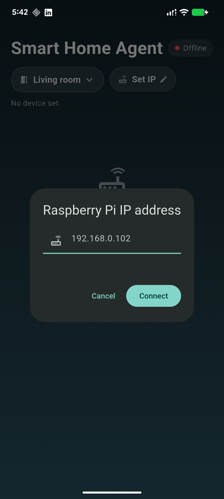
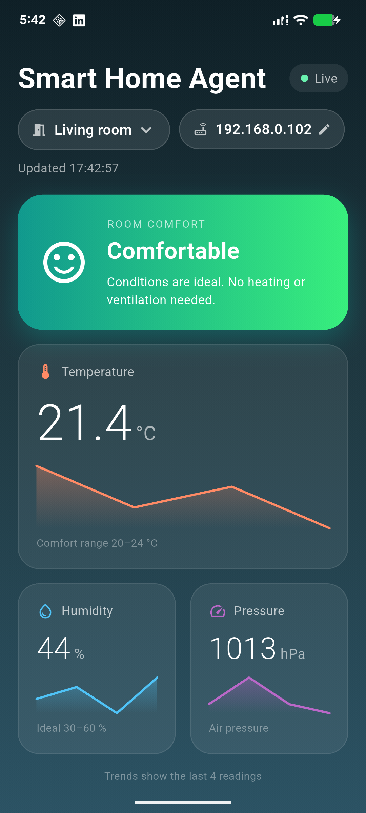

# smart-home-agent

  
  &nbsp;&nbsp;
  

### Python dependencies
- flask==3.1.1
- sense_hat==2.6.1

`json`, `os` and `time` are part of Python's standard library, so nothing to install.

---
### Run
Start the sensor loop in the background, then the server:
> python3 main.py & python3 server.py

---
